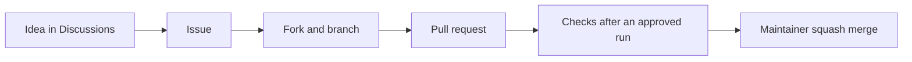

# Contributing

Thank you for helping. Every contribution takes the same path.



## 1. Start

| You have | Do |
|---|---|
| An idea | Open a [Discussion in Ideas](https://github.com/Colorado-Startups/link/discussions/categories/ideas) |
| A bug | Open an issue with the bug form |
| A security problem | [`SECURITY.md`](SECURITY.md); never a public issue |
| Time now | Pick a [`good first issue`](https://github.com/Colorado-Startups/link/labels/good%20first%20issue) |

## 2. Run it

```bash
git clone https://github.com/<you>/link
cd link
npm ci
npm test
```

## 3. Change it

| Rule | Why |
|---|---|
| One change per pull request, with a test for code | Small PRs review fast |
| `npm test` passes before you push | CI runs the same |
| Sign off each commit: `git commit -s` | The DCO check requires it |
| No secrets, personal data or contact data | The repo is public |
| Say so when an AI tool wrote part of the change | Reviewers read it with that in mind |

## 4. Review and merge

A maintainer reviews every PR and squash-merges it once CI and DCO pass. A fork's run waits for approval and gets no secrets.
