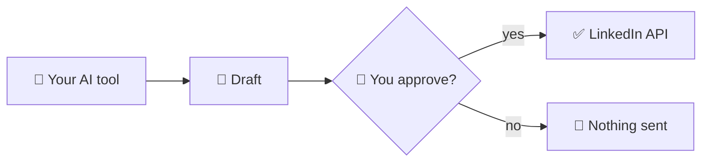

# Linken

Your LinkedIn, run by Claude. Nothing posts until you click.

| ✍️ Post | 📥 Inbox | 🧹 Clean up |
| --- | --- | --- |
| Posts, comments and replies you approve | Drafts replies from your own data export | Rates connections and paces the pruning |

## 🎒 Try it in 2 minutes

| Step | Do |
| --- | --- |
| 1 | `npm run sample` |
| 2 | Claude: `archive_load` `~/.linken-sample` |
| 3 | `connections_summary` |

## Install

| # | Do |
| --- | --- |
| 1️⃣ | `/plugin install linken --marketplace Colorado-Startups/linken` |
| 2️⃣ | Make a LinkedIn app and a token: [setup](docs/setup.md) |
| 3️⃣ | Ask Claude to call `linken_status` |

## 🛡️ Safety

| Guard | How |
| --- | --- |
| 👤 Approval dialog | Every post waits for your click |
| 🛑 Halt file | Create `~/.linken/halt` and actions stop |
| ⏱️ Pace caps | A daily cap and random gaps |
| 🏠 Data stays on your Mac | Token in the Keychain, ledger in `~/.linken` |
| 🚫 Removes nothing itself | You or your browser agent click Remove, one at a time |

## Links

| Page | Where |
| --- | --- |
| 📊 Quality | <https://colorado-startups.github.io/linken/> |
| ⚙️ Process | <https://colorado-startups.github.io/linken/process.html> |
| 🔧 Setup | [docs/setup.md](docs/setup.md) |
| 🔌 Connections guide | [docs/connections.md](docs/connections.md) |
| 📜 Legal | [Apache-2.0](LICENSE), [trademarks](TRADEMARKS.md) |

Open source from Colorado Startups. Check its work before anything posts. Not affiliated with LinkedIn or Anthropic.
