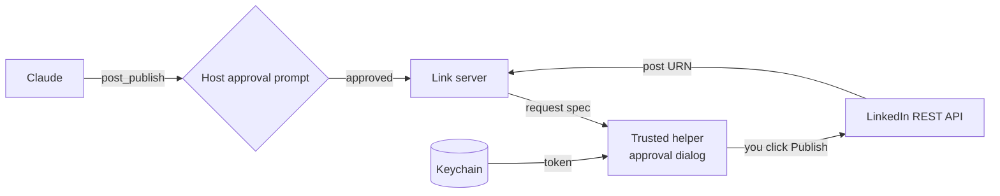

# Link

A small local MCP server that lets Claude publish to LinkedIn as the signed-in member, through LinkedIn's official REST API. macOS only.

Not affiliated with LinkedIn or Anthropic.

| Part | Is |
| --- | --- |
| Server | One local MCP server over stdio. TypeScript that Node runs directly: no build step. It never sends, stores or returns the LinkedIn token |
| Trusted helper | [trusted/link-linkedin](trusted/README.md): the one program that uses the token. Installed as root-owned files, outside any checkout |
| Approval dialog | Lives in the helper. Every write shows what will be sent and goes out only on a click on Publish |
| Ledger | One JSON line per published post in `~/.link/ledger.jsonl`, readable by its owner only |
| Skill | [skills/link-post](skills/link-post/SKILL.md): how to publish, and how to render [templates/carousel.html](templates/carousel.html) to a PDF |

## What it does today

| Tool | Kind | Does |
| --- | --- | --- |
| `link_status` | Read | Member name, author URN, whether the token works, pinned API version, dry-run state, last 5 ledger lines |
| `post_publish` | Write | Publishes text, a link, one image, or one PDF (a carousel) on your own profile, after the dialog. |
| `comment_create` | Write | Comments on a post or replies under a comment, after the dialog. If LinkedIn refuses the endpoint, the text goes to the clipboard and the post opens for you to paste |
| `archive_load` | Local | Reads your LinkedIn data export, rates every connection and finds the threads waiting on you |
| `connections_list`, `connections_mark`, `connections_next`, `connections_check` | Local | Paged cleanup of connections: list, mark, next to remove at a safe pace, check a profile before removal |
| `inbox_next` | Local | Threads whose last message is not yours, newest first, with the last 3 messages as quoted data |
| `inbox_mark` | Local | Marks a thread done, skip or spam |
| `reply_open` | Mac | Puts your approved reply on the clipboard and opens the thread; you press Cmd+V and Enter. Link sends no message |

`post_publish` input: `text` (required), `media` (absolute path to a `.pdf`, `.png`, `.jpg`, `.jpeg` or `.gif`), `title` (required for a PDF), `visibility` (`PUBLIC` or `CONNECTIONS`, default `PUBLIC`).

## How the safety model works

| Rule | Enforced by |
| --- | --- |
| The server never holds the token | Every tool call errors if `LINKEDIN_ACCESS_TOKEN` is in the server's environment |
| The helper gets the token through a pipe, never a command line | The [launcher](trusted/link-linkedin) |
| Child processes get `HOME`, `USER`, `LOGNAME`, `PATH` and `TMPDIR` only | `childEnv` in `src/` |
| No caller can skip the dialog | The helper, not the server, asks |

## Quick start

| Step | Do |
| --- | --- |
| Install | Node 26 or newer (the version CI tests), then `npm ci` |
| Set up | Follow [docs/setup.md](docs/setup.md): `sudo ./install.sh`, a LinkedIn app, a token in the Keychain, an `.mcp.json` entry |
| Rehearse | Start with `LINK_DRY_RUN=1`, call `post_publish`, and read the requests it returns |

## Tests

`npm test` runs unit, functional and end-to-end tests (Node's test runner, a fake LinkedIn, a fake helper). No test can post: no token, no network, no dialog. CI runs them on every pull request.

## Quality and Process

| Page | Link |
| --- | --- |
| Quality, Speed and Consumption | <https://colorado-startups.github.io/link/> |
| Process | <https://colorado-startups.github.io/link/process.html> |

## Contributing and licence

[CONTRIBUTING](CONTRIBUTING.md), [SECURITY](SECURITY.md), [SUPPORT](SUPPORT.md), [GOVERNANCE](GOVERNANCE.md). Licence: Apache-2.0 ([LICENSE](LICENSE), [NOTICE](NOTICE)).

Not affiliated with LinkedIn or Anthropic. Each person who runs Link creates their own LinkedIn app and is the developer under LinkedIn's API Terms.
