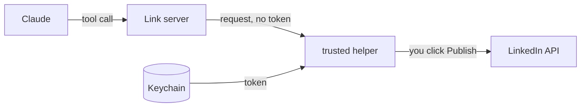

# Link

A local MCP server that lets Claude post and comment on LinkedIn for you, through LinkedIn's official API, with every write approved by you in a macOS dialog. macOS only. Not affiliated with LinkedIn or Anthropic.

## What it does

| # | Job | Tools | How far LinkedIn lets it go |
| --- | --- | --- | --- |
| 1 | Post | `post_publish`: text, a link, one image or a PDF carousel | Full |
| 2 | Comment and reply | `comment_create`: a post link, or a "Copy link to comment" link to reply | Full; if LinkedIn refuses the endpoint, the text goes to your clipboard |
| 3 | Messages | `archive_load`, `inbox_next`, `inbox_mark`, `reply_open` | No messaging API: Link drafts from your data export, you press Enter |
| 4 | Connections | `connections_list`, `_mark`, `_next`, `_check` | No removal API: Link rates and paces, you remove |
| | Status | `link_status` | Token, API version, last 5 ledger lines |

Skills that drive each job: [link-post](skills/link-post/SKILL.md), [link-inbox](skills/link-inbox/SKILL.md), [link-cleanup](skills/link-cleanup/SKILL.md).

## Safety

| Rule | Enforced by |
| --- | --- |
| The server never holds the token | Every tool errors if `LINKEDIN_ACCESS_TOKEN` is in its environment |
| Only a root-owned helper uses it, through a pipe | [trusted/](trusted/README.md), [THREAT-MODEL.md](THREAT-MODEL.md) |
| No caller can skip the dialog | The helper asks, not the server |
| Each post appends a line to `~/.link/ledger.jsonl` | Owner-readable only |

## Install

| Way | Do |
| --- | --- |
| Claude Code or Cowork | `/plugin install link --marketplace Colorado-Startups/link` |
| By hand, any host | [docs/setup.md](docs/setup.md): `sudo ./install.sh`, a LinkedIn app, `link-token`, one config block |
| Rehearse | `LINK_DRY_RUN=1` returns the requests and sends nothing |

## Quality and process

| Page | Link |
| --- | --- |
| Quality, Speed and Consumption | <https://colorado-startups.github.io/link/> |
| Process | <https://colorado-startups.github.io/link/process.html> |

`npm test` runs in CI against a fake LinkedIn and a fake helper: no token, no network, no dialog.

[CONTRIBUTING](CONTRIBUTING.md) · [SECURITY](SECURITY.md) · [SUPPORT](SUPPORT.md) · [GOVERNANCE](GOVERNANCE.md) · Apache-2.0 ([LICENSE](LICENSE), [NOTICE](NOTICE)). Each person who runs Link creates their own LinkedIn app and is the developer under LinkedIn's API Terms.
