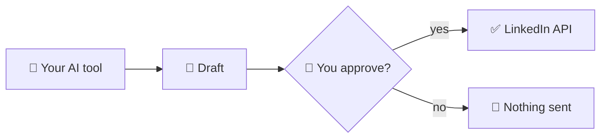

# Linken

Your LinkedIn, run by Claude. Nothing posts until you click.

| ✍️ Post | 📥 Inbox | 🧹 Clean up |
| --- | --- | --- |
| Posts, comments and replies you approve | Drafts replies from your own data export | Keeps who matters, removes clear spam, paced |

## 🎒 Try it in 2 minutes

| # | |
| --- | --- |
| 1 | `npm run sample` |
| 2 | Claude: `archive_load` `~/.linken-sample` |
| 3 | `connections_summary` |

## Install

| # | Do |
| --- | --- |
| 1️⃣ | `/plugin install linken --marketplace Colorado-Startups/linken` |
| 2️⃣ | Make a LinkedIn app and a token: [setup](docs/setup.md) |
| 3️⃣ | Ask Claude to call `linken_status` |

## 🛡️ Safety

| Guard | |
| --- | --- |
| 👤 Approval | Every post waits for your click |
| 🛑 Halt | `~/.linken/halt` stops everything |
| ⏱️ Pace | Daily caps, random gaps |
| 🏠 Local | Token in the Keychain, data in `~/.linken` |
| 🔎 Proof | Nobody is removed on old data: the live profile decides |

## Links

| Page | |
| --- | --- |
| 📊 Quality | <https://colorado-startups.github.io/linken/> |
| ⚙️ Process | <https://colorado-startups.github.io/linken/process.html> |
| 🔧 Setup | [docs/setup.md](docs/setup.md) |
| 🧭 How it decides | [docs/decide.md](docs/decide.md) |
| 🧹 Clean-up guide | [docs/connections.md](docs/connections.md) |
| 🧩 Code | `src/` server · `rules/` word lists · `tests/` · `quality/` scores |
| 📜 Legal | [Apache-2.0](LICENSE), [trademarks](TRADEMARKS.md) |

Open source from Colorado Startups. Not affiliated with LinkedIn or Anthropic.
