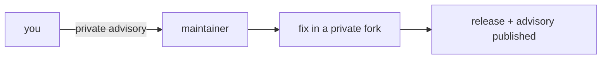

# Security

## Report a vulnerability

| Way | Use it for |
|---|---|
| [Report a vulnerability](https://github.com/Colorado-Startups/link/security/advisories/new) (GitHub private reporting) | Anything in this repo |

Please do not open a public issue. A maintainer replies.

## How outside code is kept safe

| Control | Where |
|---|---|
| Every fork run waits for approval and gets no secrets | Repo settings; `pull_request`, never `pull_request_target` with a fork checkout |
| Secret scanning and push protection on | Repo settings |
| The token-holding helper is installed as root-owned files, outside any checkout | [`trusted/README.md`](trusted/README.md) |
