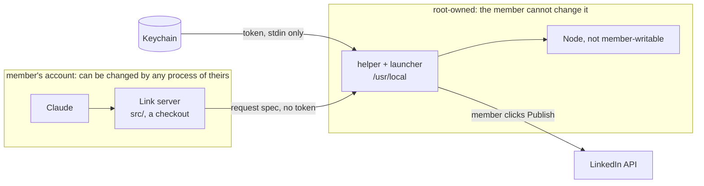

# Threat model

The one asset is the member's LinkedIn token, and with it the power to post as them. Reviewed 2026-11-13.

| Threat | Control | Proof |
|---|---|---|
| A prompt-injected Claude posts or comments | Every write shows a macOS dialog; Cancel is the default | `tests/helper.test.ts` "the gate" |
| A session edits the server to leak the token | The server never holds it; every tool errors while it is in the server's environment | `tests/child-env.test.ts` |
| A session edits the helper | Root-owned, outside any checkout | `install.sh` |
| A swapped Node reads the token | `install.sh` refuses a Node the member can write | issue #2, `install.sh` |
| The token on a command line (`ps`) | Launcher: fd 3 here-document; `link-token`: `security -i` stdin | `tests/launcher.test.ts`, `tests/token.test.ts` |
| The token sent to another host | Host pinning; no redirects; 3 headers at most | `tests/helper.test.ts` |
| A message in the inbox steers Claude | Message text is returned as quoted data; Link sends no message | `skills/link-inbox` |
| A fork's PR changes trusted code | `tools/merge_policy.json`: maintainer only | `CODEOWNERS` |

| Accepted risk | Why |
|---|---|
| A process running as the member can read the Keychain item after the member allows it | macOS's own prompt guards it; same as any CLI token |
| An upload needs no dialog | A file shows only through a post, which needs one |
| The real dialog is untested in CI | Tests fake `osascript`; first live use proves it (issue #3) |
