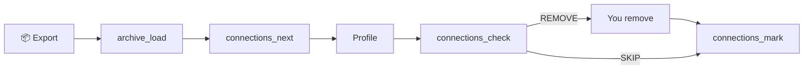
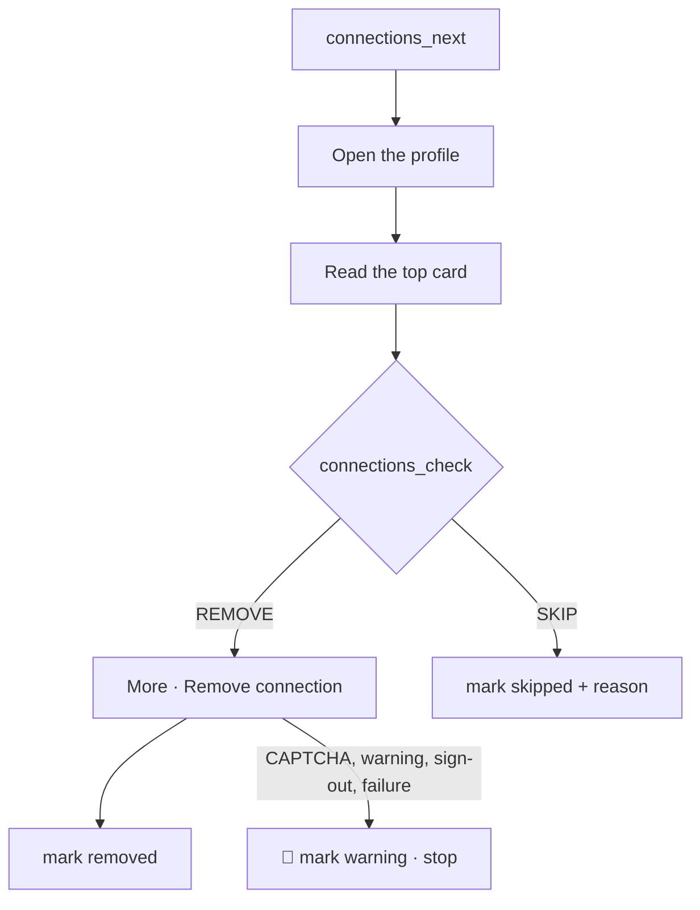

# Clean up your connections

Your export, on your Mac. Linken removes nothing itself. Who goes: [How Linken decides](decide.md).

## 1 · Rate

| # | First match wins | Tier · reason |
|---|---|---|
| 1 | Your mark | KEEP or REMOVE · `override` |
| 2 | You started a thread, or sent 2+ messages | PROTECTED · `thread` |
| 3 | Endorsement or recommendation | PROTECTED · `endorsed` |
| 3b | You sent the invitation | PROTECTED · `invited` |
| 4 | On a keep list | PROTECTED · `keeplist` |
| 5 | Connected within 90 days, no pitch | PROTECTED · `new` |
| 6 | Wrote first with a pitch, never answered | REMOVE · `pitch` |
| 7 | A `sales` word in the title | REMOVE · `sales` |
| 8 | `mission` or `places` words | KEEP · `mission` |
| 9 | No title, no company | REMOVE · `empty` |
| 10 | No messages, over a year | REMOVE · `low` |
| 11 | Anything else | REVIEW · `other` |

A REMOVE tier removes nobody: [levels](decide.md) and the live page decide.

## 2 · Check and remove: the profile lane

| Step | Do |
|---|---|
| 👀 Read | Name, degree, headline, location, company, mutuals. Never guess |
| 💾 Save | Mark every removal and skip; a removal is final |
| ✅ Verify | Header total drops by exactly the removals |

List lane: `connections_check_list` checks up to 40 rows of My Network, Connections. Rows show no company or mutuals, so blank profiles wait for the profile lane.

## 3 · Pace

| Days since a warning | Per day | Per sitting |
|---|---|---|
| 1 to 3 | 25 | 25 |
| 4 to 7 | 50 | 25 |
| 8 on | 80 | 40 |

| Rule | Value |
|---|---|
| ⏱️ Gap | 15 to 45 s, random (`LINKEN_GAP`) |
| 🪑 Sitting | Ends after 30 minutes idle |
| 🛑 Warning | `connections_mark warning` writes the halt file; everything stops until you delete it |

## Settings

| Variable | Use |
|---|---|
| `LINKEN_HOME` | Data folder, default `~/.linken` |
| `LINKEN_RATER` | Rules file, default `~/.linken/rater.json` |
| `LINKEN_DAILY_CAP`, `LINKEN_SITTING_CAP` | Lower a cap; never raise it |
| `LINKEN_HALT_FILE` | Halt file path |

Removal is silent, but deletes endorsements between you.
