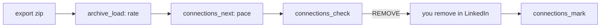
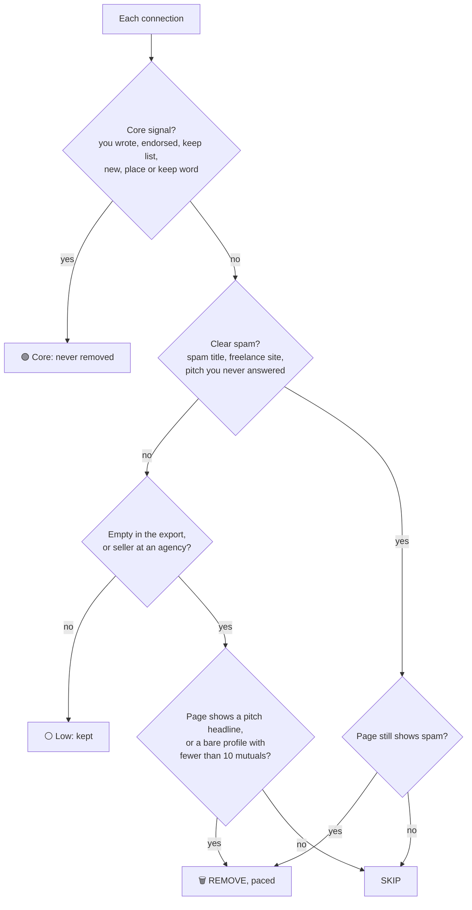
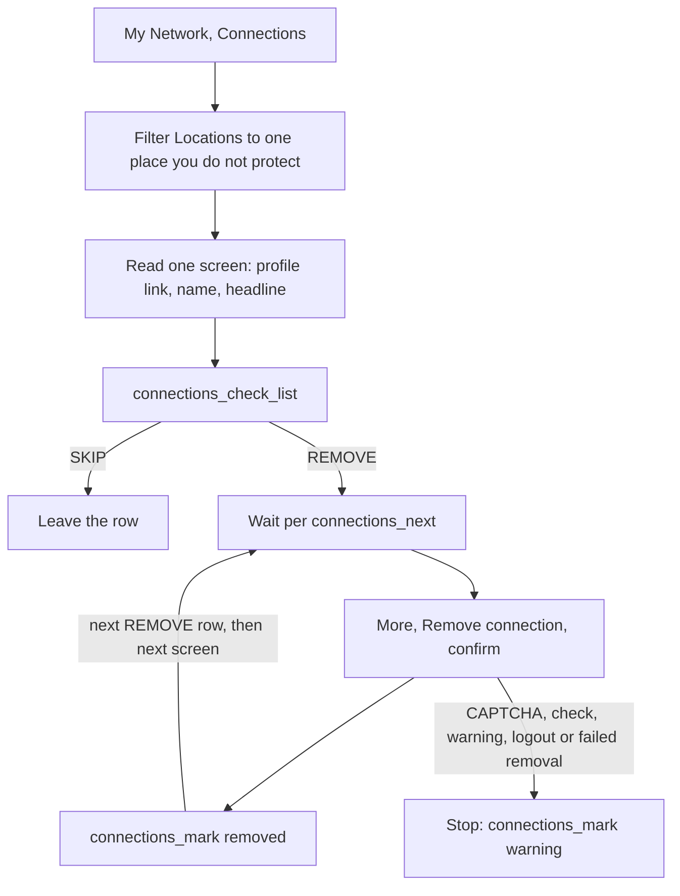

# Rate and clean up your connections



## How Linken decides

The goal: keep every contact who matters, and remove only clear spam and bare profiles. Checks run top to bottom; the first that matches decides. Nothing is removed on the export alone: the profile page, as it is today, must agree.



| Level | Who | What happens |
|---|---|---|
| 🟢 Core | You started a thread or wrote twice, endorsements or recommendations either way, keep lists, connected in the last 90 days, a `places` match, `mission` words | Never removed |
| 🔴 Spam | Your remove mark, a pitch you never answered, `spam_titles`, `spam_companies` | Checked first. Removed only if the page still shows it (marks and pitches need no page proof) |
| 🟠 Borderline | Empty title and company in the export, or a `sales` title at a `seller_companies` company | Removed only on a `seller_headlines` headline, or a bare page: no headline, no company and fewer than `bare_mutuals` mutual connections |
| ⚪ Low | Everything else, including ordinary sales jobs and people you have not talked to in years | Kept |
| ⛔ No link | Export rows with no profile URL | Never matched, never removed |

| On the page | Always wins |
|---|---|
| A `places` word in the location or company | SKIP, even over your own remove mark |
| A `mission` word in the headline or company | SKIP, except over your own remove mark. A keep word beats a pitch |
| Name differs, or not 1st degree | SKIP |

Keep words are yours. A startup-community overlay could start with:

```json
{ "mission": ["founder", "cofounder", "ceo", "chief", "partner", "president", "investor", "venture", "angel", "startup",
  "accelerator", "incubator", "community", "ecosystem", "entrepreneur", "ai", "government", "policy"],
  "places": ["your city", "your state"] }
```

## Step 1: the rater

Linken rates your connections from your own LinkedIn data export (Settings, Data privacy, Get a copy of your data). It reads local files only, never talks to LinkedIn, and removes nothing. Tools: `archive_load`, `connections_list`, `connections_mark`, `connections_next`, `connections_check`, `connections_check_list`, `connections_summary`.

| # | Rule, first match wins | Tier, reason |
|---|---|---|
| 1 | Your mark | KEEP or REMOVE, `override` |
| 2 | You started a 1:1 thread, or sent 2 or more messages | PROTECTED, `thread` |
| 3 | Endorsement or recommendation, either way | PROTECTED, `endorsed` |
| 4 | On a keep list | PROTECTED, `keeplist` |
| 5 | Connected within 90 days, no pitch | PROTECTED, `new` |
| 6 | They wrote first with a pitch phrase, you never replied | REMOVE, `pitch` |
| 7 | Sales, lead-generation, recruiter or MLM words in the position | REMOVE, `sales` |
| 8 | Mission words or places in position or company | KEEP, `mission` |
| 9 | No position and no company | REMOVE, `empty` |
| 10 | No message either way, connected over a year | REMOVE, `low` |
| 11 | Anything else | REVIEW, `other` |

The tiers feed the levels above. A REMOVE tier alone removes nobody: `low` and ordinary `sales` rows are kept, and the rest need live proof.

Default word lists: `rules/rater.default.json`. `LINKEN_RATER` names a JSON overlay: lists are added, numbers replace. Mission words, `places` and `keep_files` (CSV with a `url`, `email`, or `first_name` and `last_name` column) belong in your overlay.

| Days with removals since the last warning | Per day | Per sitting |
|---|---|---|
| 1 to 3 | 25 | 25 |
| 4 to 7 | 50 | 25 |
| 8 on | 80 | 40 |

A sitting ends after 30 minutes idle. Days are your local calendar days. `connections_next` waits 15 to 45 seconds after the last removal or skip. A corrupt `removals.json` is an error naming the file, not an empty history. A `warning` mark writes `LINKEN_HALT_FILE`; while it exists, `connections_next`, `post_publish`, `comment_create` and `reply_open` refuse until you delete it.

## The Connections-list lane



| Step | Do |
| --- | --- |
| 1. Open | My Network, Connections |
| 2. Filter | Locations: one place you do not protect (never a place in your `places` list) |
| 3. Read | One screen of rows: profile link, name, headline, and the location if the row shows it. Rows show no company or mutuals, so a borderline row is never removed here; use the profile lane for those |
| 4. Check | `connections_check_list` with up to 40 rows; it returns REMOVE or SKIP with a reason per row and records nothing |
| 5. Remove | For each REMOVE: wait as `connections_next` says, More, Remove connection, confirm, then `connections_mark` `removed` |
| 6. Stop | On any CAPTCHA, check, warning, logout or failed removal: `connections_mark` `warning` and stop |
| 7. Verify | Compare the total connection count in the page header before and after. The filtered count lags, so never use it |

`connections_summary` shows the queue, today and this sitting against their caps, and the last warning.

| Variable | Use |
|---|---|
| `LINKEN_HOME` | Folder for `connections.json`, `removals.json`, `archive/` (default `~/.linken`) |
| `LINKEN_RATER`, `LINKEN_HALT_FILE` | Overlay JSON path, halt file path |
| `LINKEN_DAILY_CAP`, `LINKEN_SITTING_CAP` | A whole number that lowers the per-day or per-sitting cap above. A higher, zero or malformed value is ignored, so these can slow Link down but never speed it up |
| `LINKEN_OWNER_URL`, `LINKEN_GAP` | Your profile URL if messages do not show you; wait range, default `15-45` |

To remove a connection yourself: open the profile, More, Remove connection. The other person is not notified. Endorsements and recommendations between you are deleted.
