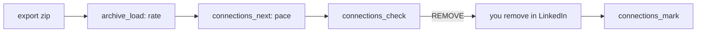
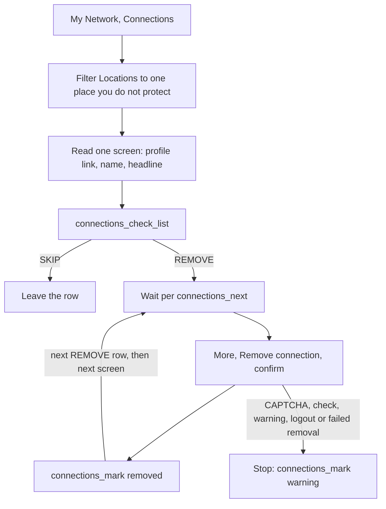

# Rate and clean up your connections

Link rates your connections from your own LinkedIn data export (Settings, Data privacy, Get a copy of your data). It reads local files only, never talks to LinkedIn, and removes nothing. Tools: `archive_load`, `connections_list`, `connections_mark`, `connections_next`, `connections_check`, `connections_check_list`, `connections_summary`.

| # | Rule, first match wins | Tier, reason |
|---|---|---|
| 1 | Your mark | KEEP or REMOVE, `override` |
| 2 | You started a 1:1 thread, or sent 2 or more messages | PROTECTED, `thread` |
| 3 | Endorsement or recommendation, either way | PROTECTED, `endorsed` |
| 4 | On a keep list | PROTECTED, `keeplist` |
| 5 | Connected within 90 days, no pitch | PROTECTED, `new` |
| 6 | They wrote first with a pitch phrase, you never replied | REMOVE, `pitch` |
| 7 | Sales, lead-generation, recruiter or MLM words in the position | REMOVE, `sales` |
| 8 | Mission words or places in position or company | KEEP, `mission` |
| 9 | No position and no company | REMOVE, `empty` |
| 10 | No message either way, connected over a year | REMOVE, `low` |
| 11 | Anything else | REVIEW, `other` |

Default word lists: `rules/rater.default.json`. `LINKEN_RATER` names a JSON overlay: lists are added, numbers replace. Mission words, `places` and `keep_files` (CSV with a `url`, `email`, or `first_name` and `last_name` column) belong in your overlay.

| Days with removals since the last warning | Per day | Per sitting |
|---|---|---|
| 1 to 3 | 25 | 25 |
| 4 to 7 | 50 | 25 |
| 8 on | 80 | 40 |

A sitting ends after 30 minutes idle. Days are your local calendar days. `connections_next` waits 15 to 45 seconds after the last removal or skip. A corrupt `removals.json` is an error naming the file, not an empty history. A `warning` mark writes `LINKEN_HALT_FILE`; while it exists, `connections_next`, `post_publish`, `comment_create` and `reply_open` refuse until you delete it.

## The Connections-list lane

| Step | Do |
| --- | --- |
| 1. Open | My Network, Connections |
| 2. Filter | Locations: one place you do not protect (never a place in your `places` list) |
| 3. Read | One screen of rows: profile link, name, headline, and the location if the row shows it |
| 4. Check | `connections_check_list` with up to 40 rows; it returns REMOVE or SKIP with a reason per row and records nothing |
| 5. Remove | For each REMOVE: wait as `connections_next` says, More, Remove connection, confirm, then `connections_mark` `removed` |
| 6. Stop | On any CAPTCHA, check, warning, logout or failed removal: `connections_mark` `warning` and stop |
| 7. Verify | Compare the total connection count in the page header before and after. The filtered count lags, so never use it |

`connections_summary` shows the queue, today and this sitting against their caps, and the last warning.

| Variable | Use |
|---|---|
| `LINKEN_HOME` | Folder for `connections.json`, `removals.json`, `archive/` (default `~/.linken`) |
| `LINKEN_RATER`, `LINKEN_HALT_FILE` | Overlay JSON path, halt file path |
| `LINKEN_DAILY_CAP`, `LINKEN_SITTING_CAP` | A whole number that lowers the per-day or per-sitting cap above. A higher, zero or malformed value is ignored, so these can slow Link down but never speed it up |
| `LINKEN_OWNER_URL`, `LINKEN_GAP` | Your profile URL if messages do not show you; wait range, default `15-45` |

To remove a connection yourself: open the profile, More, Remove connection. The other person is not notified. Endorsements and recommendations between you are deleted.
