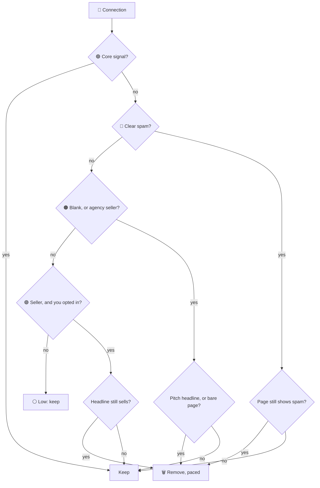

# How Linken decides

🎯 Keep everyone who matters. Remove only clear spam, bare profiles and, if you opt in, people who still sell. The export can be years old, so the profile page decides.

## Levels

| Level | Who | Removed when |
|---|---|---|
| 🟢 Core | You wrote, endorsed, invited · keep list · new · `places` · `mission` words | Never |
| 🔴 Spam | Your remove mark · pitch you never answered · `spam_titles` · `spam_companies` | The page still shows it (marks and pitches: always) |
| 🟠 Borderline | Blank in the export · `sales` title at a `seller_companies` firm | Pitch headline, or bare page: no headline, no company, under `bare_mutuals` (10) mutuals |
| 🟣 Seller | A `sales` title | Only with `"also_remove": ["seller"]`, while the headline still sells |
| ⚪ Low | Everyone else, including people you have not talked to in years | Never |
| ⛔ No link | No profile URL in the export | Never |

## The page always wins

| Page shows | Verdict |
|---|---|
| 📍 A `places` word in location or company | SKIP, even over your mark |
| 🔑 A `mission` word in headline or company | SKIP, except over your mark |
| 🪪 Another name, or not 1st degree | SKIP |
| 🤔 Someone who clearly matters | SKIP: keeping costs nothing |

## Your words

| File | Use |
|---|---|
| [`rules/rater.default.json`](../rules/rater.default.json) | Generic lists, shipped |
| [`rules/starter.startups.json`](../rules/starter.startups.json) | Startup-community keep words: copy to `~/.linken/rater.json` |
| `~/.linken/rater.json` | Yours: `mission`, `places`, `also_remove`. Found with no setting; `LINKEN_RATER` points elsewhere |

Lists add to the defaults; numbers replace them. Code: [`src/levels.ts`](../src/levels.ts), two tables, first match wins.
