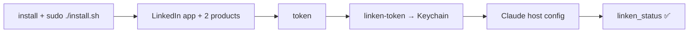

# Set up Linken

macOS only. You create your own LinkedIn app and are its developer under LinkedIn's API Terms. Not affiliated with LinkedIn or Anthropic.



| Step | Do |
| --- | --- |
| 1. Install | Node 26 or newer. `git clone https://github.com/Colorado-Startups/linken && cd linken && npm ci` |
| 2. Install the helper | `sudo ./install.sh`: 3 root-owned files and their SHA-256. It refuses a Node your account can write, and never touches a token |
| 3. Create a LinkedIn app | In the [LinkedIn Developer Portal](https://www.linkedin.com/developers/apps), create an app named without "LinkedIn" or "In", linked to a Page you administer |
| 4. Add products | On the app's Products tab, add **Share on LinkedIn** and **Sign In with LinkedIn using OpenID Connect** |
| 5. Make a token | Developer Portal, Token Generator: pick `openid profile w_member_social`, then generate. Tokens last 60 days, with no refresh; repeat steps 5 and 6 to renew |
| 6. Store it | `linken-token`: paste it in the hidden dialog. It goes to your Keychain as `linken-linkedin` |
| 7. Add to your Claude host | One row of the table below |
| 8. Check | Ask Claude to call `linken_status`. Rehearse with `LINKEN_DRY_RUN=1` before a live post |

| Host | Do | Gets |
| --- | --- | --- |
| Claude desktop, Chat and Code tab | Settings, Developer, Edit Config: add the block below, then restart Claude | Tools |
| Claude Code or Cowork plugin | `/plugin install linken --marketplace Colorado-Startups/linken` (Claude Code 2.1.275 or later) | Tools and the 3 skills |
| A project's `.mcp.json` | The block below, in that file | Tools |
| Skills in Chat | Zip a folder from `skills/`, then Customize, Skills, Upload a skill | Skills |

If Claude cannot find `node`, put its absolute path in `command`. Sources: [connect local servers](https://modelcontextprotocol.io/docs/develop/connect-local-servers), [plugins](https://code.claude.com/docs/en/plugins-reference), [skills](https://support.claude.com/en/articles/12512180-use-skills-in-claude), read 2026-11-13.

```json
{
  "mcpServers": {
    "linken": {
      "command": "node",
      "args": ["/absolute/path/to/linken/src/server.ts"],
      "env": {
        "LINKEN_HELPER_CMD": "[\"/bin/sh\",\"-c\",\"LINKEDIN_ACCESS_TOKEN=\\\"$(/usr/bin/security find-generic-password -s linken-linkedin -w)\\\" exec /usr/local/bin/linken-linkedin\"]"
      }
    }
  }
}
```

| Variable | Needed | Meaning |
| --- | --- | --- |
| `LINKEN_HELPER_CMD` | Yes, for live calls | JSON array that starts the helper with the token (above) |
| `LINKEN_HOME` | No | Data folder. Default `~/.linken` |
| `LINKEN_DRY_RUN` | No | `1` calls no helper and writes no ledger line |
| `LINKEN_GATES` | No | Commands that read each write as JSON on stdin and can block it |

The token goes Keychain → helper, never into the server. A `LINKEDIN_ACCESS_TOKEN` in the server's own environment makes every call error.

## ✅ First live use

| Check | When |
| --- | --- |
| 👤 The approval dialog shows the draft | First `LINKEN_DRY_RUN=1` run, then the first post |
| 🖼️ Image and PDF upload | The first of each |
| #️⃣ Hashtags and brackets show as written | The first post with them |
| 🪪 You are the post's author | The first post |
