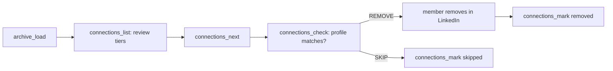

# Clean up LinkedIn connections

LinkedIn has no API to remove a connection. Link rates and paces; the member removes each one in LinkedIn.

| Step | Do |
| --- | --- |
| 1. Load | `archive_load` with the full export (Connections.csv is not in the fast one) |
| 2. Review | `connections_list` by tier and reason; `connections_mark` `keep` or `remove` to override |
| 3. Next | `connections_next` returns one, after its caps and wait |
| 4. Check | Open the profile; pass what it shows to `connections_check` |
| 5. Remove | On REMOVE the member opens More, Remove connection, then you `connections_mark` `removed` |

| Cap | Value |
| --- | --- |
| Per day | 25, then 50 from day 4, 80 from day 8 since the last warning |
| Per sitting | 25, or 40 from day 8; a sitting ends after 30 minutes idle |
| Between removals | 15 to 45 seconds, random |

| Rule | Why |
| --- | --- |
| Any LinkedIn warning: `connections_mark` `warning` at once | It writes the halt file, which stops removals, posts, comments and replies |
| Never remove without a REMOVE from `connections_check` | The rating can be stale |
| Removal is silent to the other person, but deletes endorsements and recommendations between you | Say so before the first one |
