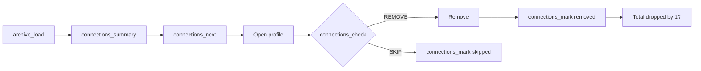

# Clean up LinkedIn connections

LinkedIn has no API to remove a connection. Linken rates and paces; the member, or their browser agent, clicks Remove. Goal: keep everyone who matters. Who goes: `docs/decide.md`.

| Step | Do |
|---|---|
| 0 · Try | `npm run sample`, then `archive_load` `~/.linken-sample` |
| 1 · Load | `archive_load` the full export (Connections.csv is not in the fast one) |
| 2 · Show | Draw `connections_summary`: levels as bars, queue, today against its cap |
| 3 · Sample | Show the member the first names `connections_next` would bring, with title and reason. Start on their OK |
| 4 · Next | `connections_next`: spam first, then borderline, then sellers if opted in |
| 5 · Read | Open the profile. Pass exactly what the top card shows: name, degree, headline, location, current company, mutuals (0 if none) |
| 6 · Check | `connections_check`. Remove only on REMOVE |
| 7 · Save | `connections_mark` `removed` or `skipped`, every time, with the reason |
| 8 · Verify | The header's total drops by exactly the removals |

## Rules

| Rule | Why |
|---|---|
| 🛑 Any CAPTCHA, check, warning, sign-out or failed removal: `connections_mark warning`, stop | Writes the halt file; 7 days off, then half pace |
| 🤔 Page shows someone who clearly matters: skip, even on REMOVE | A wrong removal costs the relationship |
| 🧾 Never guess a top-card field | A guess can turn a keep into a remove |
| 🔁 Removed is final | `connections_mark` refuses a later mark |
| 🪙 Keep reads small | `find` and accessibility reads over screenshots |
| 📣 Before the first removal, say it is silent but deletes endorsements between you | No surprises |

| Cap | Value |
|---|---|
| Per day | 25, then 50 from day 4, 80 from day 8 since a warning |
| Per sitting | 25, or 40 from day 8 |
| Gap | 15 to 45 s, random |
