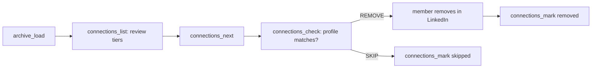
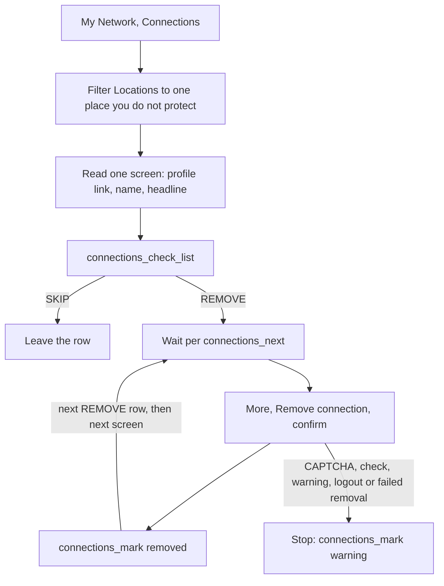

# Clean up LinkedIn connections

LinkedIn has no API to remove a connection. Linken rates and paces; the member removes each one in LinkedIn. The aim is to keep every contact who matters: clear spam goes first, borderline only on live proof, and core and low are never removed. The decision model, drawn: `docs/connections.md`, "How Linken decides".

| Step | Do |
| --- | --- |
| 0. Try it | `npm run sample` writes a fictional export to `~/.linken-sample`; `archive_load` it, then `connections_summary` |
| 1. Load | `archive_load` with the full export (Connections.csv is not in the fast one) |
| 2. Review | `connections_list` by tier and reason; `connections_mark` `keep` or `remove` to override |
| 3. Next | `connections_next` returns one, spam first, then borderline, after its caps and wait |
| 4. Check | Open the profile; pass exactly what the top card shows to `connections_check`: name, degree, headline, location, current company, and mutual connections (0 when none show). Never guess a field |
| 5. Remove | On REMOVE the member opens More, Remove connection, then you `connections_mark` `removed` |

## The Connections-list lane

When you filter the list by place instead of opening each profile, use `connections_check_list` for the checks. Pacing is unchanged.

| Step | Do |
| --- | --- |
| 1. Open | My Network, Connections |
| 2. Filter | Locations: one place you do not protect (never a place in your `places` list) |
| 3. Read | One screen of rows: profile link, name, headline, and the location if the row shows it |
| 4. Check | `connections_check_list` with up to 40 rows; it returns REMOVE or SKIP with a reason per row and records nothing |
| 5. Remove | For each REMOVE: wait as `connections_next` says, More, Remove connection, confirm, then `connections_mark` `removed` |
| 6. Stop | On any CAPTCHA, check, warning, logout or failed removal: `connections_mark` `warning` and stop |
| 7. Verify | Compare the total connection count in the page header before and after. The filtered count lags, so never use it |

`connections_summary` shows the queue, today and this sitting against their caps, and the last warning.

| Cap | Value |
| --- | --- |
| Per day | 25, then 50 from day 4, 80 from day 8 since the last warning |
| Per sitting | 25, or 40 from day 8; a sitting ends after 30 minutes idle |
| Between removals | 15 to 45 seconds, random |

| Rule | Why |
| --- | --- |
| Any LinkedIn warning: `connections_mark` `warning` at once | It writes the halt file, which stops removals, posts, comments and replies |
| Never remove without a REMOVE from `connections_check` | The rating can be stale |
| When the page shows someone who clearly matters, skip, even on REMOVE | Keeping a contact costs nothing; a wrong removal costs the relationship |
| Removal is silent to the other person, but deletes endorsements and recommendations between you | Say so before the first one |
