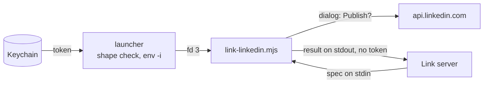

# The trusted helper

`link-linkedin` is the one program that uses the LinkedIn token and shows the approval dialog. Threats and controls: [THREAT-MODEL.md](../THREAT-MODEL.md).

| Question | Answer |
| --- | --- |
| Why separate | Code in a checkout can be edited to leak the token or skip the dialog |
| Why trusted | Root-owned files outside any checkout. Node built-ins only, no import from `src/` |
| Token source | `LINKEDIN_ACCESS_TOKEN` from the key tool that starts it; it never enters the MCP server |
| Server side | With the token in its environment, every tool errors. Children get `HOME`, `USER`, `LOGNAME`, `PATH`, `TMPDIR` only |

## Install (`sudo ./install.sh`)

| Source | Target | Mode |
| --- | --- | --- |
| [link-linkedin](link-linkedin) (the launcher) | `/usr/local/bin/link-linkedin` | root 755 |
| [link-linkedin.mjs](link-linkedin.mjs) | `/usr/local/lib/link/link-linkedin.mjs` | root 644 |
| [link-token](link-token) (hidden dialog → Keychain) | `/usr/local/bin/link-token` | root 755 |

`install.sh` refuses a Node the member can write. The launcher refuses a token outside `A-Za-z0-9._:+/=-` (exit 4); its other checks are under Guarantees.

## Contract

| Part | Shape |
| --- | --- |
| Spec (stdin) | `{ "method", "url", "headers", "json" }`, or `"file": "/absolute/path"` in place of `json` |
| Result (stdout) | `{ "status", "headers", "body" }`; headers `x-restli-id`, `location`, `content-type`, `x-li-uuid` only |
| Failure | `{ "error": "..." }` |

| Exit | Meaning |
| --- | --- |
| 0 | Sent; the HTTP status is in the result |
| 2 | Bad spec, refused host or header |
| 3 | Not approved: nothing sent |
| 4 | No token, or a misshapen one |
| 5 | Network error |

## Guarantees

Tests: [helper.test.ts](../tests/helper.test.ts) (H), [launcher.test.ts](../tests/launcher.test.ts) (L), [token.test.ts](../tests/token.test.ts) (T).

| Guarantee | Test |
| --- | --- |
| Token goes only to `api.linkedin.com` and `www.linkedin.com`; no redirects | H "host pinning", "a refused host exits 2", "a redirect is not followed" |
| 3 caller headers at most, never `Authorization` | H "header allowlist", "a caller-supplied Authorization is rejected" |
| Every write needs Publish; Cancel is the default; 600 s silence is a no | H "the gate", "not approved", "askHuman runs /usr/bin/osascript" |
| Only reads, upload registrations and uploads skip the dialog | H "a read, an upload registration and a file upload are sent without a dialog" |
| Post text is a dialog argument, never script | H "the dialog arguments" |
| Token never on stdout, stderr or a command line | H "the token never appears in the output", "run as a program"; L "the token variable is in no command's arguments"; T "a good token goes to security on stdin" |
| Node gets `HOME` and the token only (macOS adds `__CF_USER_TEXT_ENCODING` itself); the spec arrives unchanged | L "the launcher hands Node the token through a pipe" |
| The launcher is the reviewed five lines, and executable | L "the launcher is the reviewed five lines" |
| A bad token starts nothing or stores nothing | L "an empty token…"; T "a cancel, an empty answer or a bad character" |

## Limits

The dialog shows the first 700 characters, then the length. macOS only: without `/usr/bin/osascript` every write is refused. The untested real dialog and dialog-free uploads are accepted risks in [THREAT-MODEL.md](../THREAT-MODEL.md).
