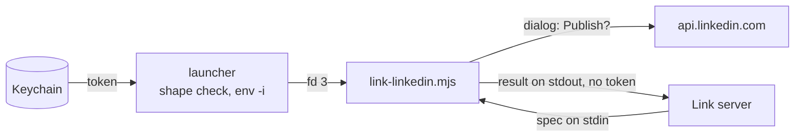

# The trusted helper

`link-linkedin` is the one program that uses the LinkedIn token and shows the approval dialog. Threats and controls: [THREAT-MODEL.md](../THREAT-MODEL.md).

| Question | Answer |
| --- | --- |
| Why separate | A session can edit a checkout, so code there could be changed to leak the token or skip the dialog |
| Why trusted | Root-owned files outside any checkout. Node built-ins only, no import from `src/` |
| Token source | `LINKEDIN_ACCESS_TOKEN` from the key tool that starts it; it never enters the MCP server |
| Server side | While the token is in the server's environment, every tool errors. Children get `HOME`, `USER`, `LOGNAME`, `PATH`, `TMPDIR` only |

## Install (`sudo ./install.sh`)

| Source | Target | Mode |
| --- | --- | --- |
| [link-linkedin](link-linkedin) (the launcher) | `/usr/local/bin/link-linkedin` | root 755 |
| [link-linkedin.mjs](link-linkedin.mjs) | `/usr/local/lib/link/link-linkedin.mjs` | root 644 |
| [link-token](link-token) (hidden dialog → Keychain) | `/usr/local/bin/link-token` | root 755 |

`install.sh` refuses a Node the member can write. The launcher exits 4 on an empty token or one outside `A-Za-z0-9._:+/=-`, starts Node with `env -i` and `HOME` only, and passes the token on fd 3, never on a command line.

## Contract

| Part | Shape |
| --- | --- |
| Spec (stdin) | `{ "method", "url", "headers", "json" }`, or `"file": "/absolute/path"` in place of `json` |
| Result (stdout) | `{ "status", "headers", "body" }`; headers `x-restli-id`, `location`, `content-type`, `x-li-uuid` only |
| Failure | `{ "error": "..." }` |

| Exit | 0 sent | 2 bad spec, host or header | 3 not approved | 4 no or misshapen token | 5 network |
| --- | --- | --- | --- | --- | --- |

## Guarantees

Tests: [helper.test.ts](../tests/helper.test.ts) (H), [launcher.test.ts](../tests/launcher.test.ts) (L), [token.test.ts](../tests/token.test.ts) (T).

| Guarantee | Test |
| --- | --- |
| Token goes only to `api.linkedin.com` and `www.linkedin.com`; no redirects | H "host pinning", "a redirect is not followed" |
| 3 caller headers at most, never `Authorization` | H "header allowlist" |
| Every write needs Publish; Cancel is the default; 600 s silence is a no | H "the gate", "not approved" |
| Only reads, upload registrations and uploads skip the dialog | H "the gate" |
| Post text is a dialog argument, never script | H "the dialog arguments" |
| Token never on stdout, stderr or a command line | H "the token never appears in the output"; L "the token variable is in no command's arguments"; T "a good token goes to security on stdin" |
| Node gets `HOME` and the token only (macOS adds `__CF_USER_TEXT_ENCODING` itself); the spec arrives unchanged | L "the launcher hands Node the token through a pipe" |
| The launcher is the reviewed five lines, and executable | L "the launcher is the reviewed five lines" |
| A bad token starts nothing or stores nothing | L "an empty token…"; T "a cancel, an empty answer or a bad character" |

## Limits

| Limit | Detail |
| --- | --- |
| Real dialog | Untested in CI (fake `osascript`); first live use proves it |
| Dialog text | First 700 characters, then the length |
| Uploads | Any readable file can upload without a dialog; it shows only through a post, which needs one |
| Platform | macOS; without `/usr/bin/osascript` every write is refused |
